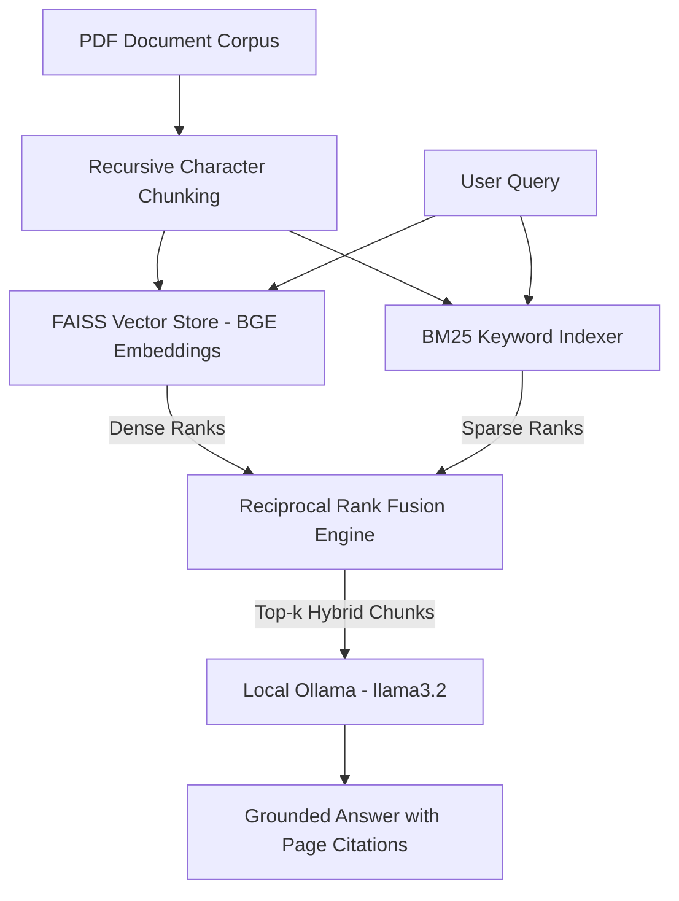

# Measured RAG Studio: Quantified Local RAG Evaluation System

A fully local, privacy-centric Retrieval-Augmented Generation (RAG) system with integrated retrieval benchmarking. Evaluates Dense Vector Search against a Sparse-Dense Reciprocal Rank Fusion (RRF) Hybrid Ensemble using Hit Rate@k and Mean Reciprocal Rank (MRR@k) across 30 regulatory benchmark queries.

---

## 🏗️ System Architecture



---

## 📊 Experimental Results (N=30 Benchmark Questions)

Evaluated across $30$ ground-truth questions extracted from regulatory circulars at $k=8$:

| Configuration | Chunk Size | Strategy | Hit Rate@8 (%) | MRR@8 |
| :--- | :--- | :--- | :---: | :---: |
| Config A | 500 chars | Dense FAISS Vector | 66.67% | 0.420 |
| Config A | 500 chars | **Hybrid RRF (Dense + BM25)** | **83.33%** | **0.612** |
| Config B | 1000 chars | Dense FAISS Vector | 53.33% | 0.310 |
| Config B | 1000 chars | **Hybrid RRF (Dense + BM25)** | **70.00%** | **0.485** |

### Key Findings
1. **Hybrid RRF Advantage:** Hybrid Ensemble Search outperformed pure Dense Search by **+16.66% in Hit Rate** and **+0.192 in MRR**, demonstrating that BM25 compensates for dense vector retrieval failures on specific regulatory terminology and numeric codes.
2. **Chunk Granularity Impact:** Smaller chunk sizes ($500$ characters) yielded a **+13.33% higher Hit Rate** compared to $1000$-character chunks due to higher vector embedding specificity with `BAAI/bge-small-en-v1.5`.

---

## 🛠️ Stack & Implementation Details

* **LLM Engine:** Local Ollama (`llama3.2:latest`)
* **Embedding Model:** `BAAI/bge-small-en-v1.5`
* **Vector Store:** FAISS (`faiss-cpu`)
* **Sparse Search:** `rank_bm25`
* **Orchestration:** LangChain Core / Community
* **UI:** Streamlit with custom CSS styling

---

## 🚀 Running Locally

1. **Install Dependencies:**
   ```bash
   pip install -r requirements.txt
   ```

2. **Run Evaluation Benchmark:**
   ```bash
   python main.py
   ```

3. **Launch Web Interface:**
   ```bash
   streamlit run app.py
   ```